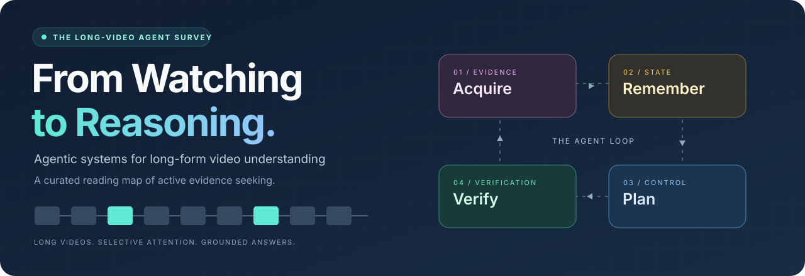

# Awesome Long-Video Agent Papers

**A curated research guide to agentic systems for long-form video understanding.**

**[Recent additions](#recent-additions)** · **[Explore the taxonomy](#taxonomy)** · **[Browse all papers](papers/index.md)** · **[Get BibTeX](references.bib)** · **[Suggest a paper](https://github.com/PhuTran1005/Awesome-Long-Video-Agent-Papers/issues/new?template=paper.yml)**

## About the Survey

This repository accompanies **From Watching to Reasoning: A Comprehensive Survey of Agentic Systems for Long-Form Video Understanding**, a survey manuscript in preparation.

Long videos make exhaustive, high-resolution processing expensive. Video agents address this challenge through **active evidence seeking**: they decide where to look, what to remember, which tool to call, and when the available evidence supports an answer. We organize this literature around four connected functions of the agent loop.

> **What makes a video system agentic?** A later video-evidence action depends on an observation made earlier in the same inference trajectory. The defining feature is feedback from observed evidence into the next action.

  
   From passive processing to adaptive evidence seeking. Click the figure to view it at full resolution.

## Recent Additions

A growing reading list of **new methods that have not yet been incorporated into the survey taxonomy**. This section provides a home for future papers as the field evolves.

**[Browse recent additions →](papers/recent-additions.md)** · **[Suggest a new method](https://github.com/PhuTran1005/Awesome-Long-Video-Agent-Papers/issues/new?template=paper.yml)**

Entries are listed by release date, newest first. Suggested categories are provisional; papers join the taxonomy catalog after review and integration into the manuscript. The taxonomy counts below cover the classified collection.

## Taxonomy

Choose a stage to explore its mechanisms, papers, and publication links.

<!-- catalog-stats:start -->
**101 unique papers · 102 citation keys · 4 stages · 16 categories**
<!-- catalog-stats:end -->

<table>
<tr>
<td width="50%" valign="top">

### 🟣 Evidence Acquisition

**Where should the agent look next?**

Retrieval-based · Hierarchical · Programmatic · Learned policy

[**Explore 33 papers →**](papers/evidence-acquisition.md)

</td>
<td width="50%" valign="top">

### 🟡 Memory & State

**What should the agent remember?**

Caption / Text · Structured · Latent / Compressed · Streaming / Online

[**Explore 32 papers →**](papers/memory-state.md)

</td>
</tr>
<tr>
<td width="50%" valign="top">

### 🔵 Control & Planning

**Which action should the agent take?**

Fixed workflow · Autonomous tool use · Multi-agent · Learned control

[**Explore 34 papers →**](papers/control-planning.md)

</td>
<td width="50%" valign="top">

### 🟢 Verification & Aggregation

**Is the evidence sufficient to answer?**

Self-consistency · Reflection / Refine · Confidence / Calibration · Evidence alignment & Adjudication

[**Explore 17 papers →**](papers/verification-aggregation.md)

</td>
</tr>
</table>

Papers can contribute to several stages, so category counts overlap. Assignments follow the manuscript taxonomy. The collection also includes **agent-enabling baselines and foundational methods**; inclusion in a branch does not imply that every method independently satisfies the closed-loop criterion.

## Find Your Reading Path

| If you are interested in… | Start here | Continue with |
| :--- | :--- | :--- |
| Searching long videos efficiently | [Retrieval-based acquisition](papers/evidence-acquisition.md#retrieval-based) | [Hierarchical acquisition](papers/evidence-acquisition.md#hierarchical) |
| Remembering events across long horizons | [Structured memory](papers/memory-state.md#structured) | [Streaming / online memory](papers/memory-state.md#streaming-online) |
| Learning to reason with video tools | [Learned acquisition policies](papers/evidence-acquisition.md#learned-policy) | [Learned control](papers/control-planning.md#learned-control) |
| Coordinating specialized agents | [Multi-agent systems](papers/control-planning.md#multi-agent) | [Evidence alignment & adjudication](papers/verification-aggregation.md#evidence-alignment-adjudication) |
| Making answers more trustworthy | [Reflection / refinement](papers/verification-aggregation.md#reflection-refine) | [Confidence / calibration](papers/verification-aggregation.md#confidence-calibration) |

For a chronological view, open the **[complete paper index](papers/index.md)** and search by method, title, or first author.

## Collection & Bibliography

The collection maps the manuscript's `sections/taxonomy.tex` to `custom.bib` using exact citation keys. Bibliographic years and venues are retained from that source; a linked preprint may have an earlier release date than the listed publication year.

| Resource | What you will find |
| :--- | :--- |
| [Recent additions](papers/recent-additions.md) | New methods awaiting taxonomy integration, with provisional categories |
| [Taxonomy paper index](papers/index.md) | A deduplicated index, organized by year, with links back to each taxonomy branch |
| [BibTeX bibliography](references.bib) | All taxonomy citation records, with their original keys |
| [Structured catalog](data/catalog.json) | Titles, authors, venues, citation aliases, and all category assignments |
| [Data notes](docs/DATA_NOTES.md) | Provenance, duplicate handling, link sources, and metadata conventions |

**Paper** links lead to publication or preprint pages. **BibTeX** links jump to the corresponding source record. Where a direct identifier is unavailable, **Find paper** explicitly opens a title search. Full author lists are available in the bibliography and structured catalog.

## Contributing

Relevant papers, metadata corrections, and taxonomy suggestions are welcome. Please include a primary publication link and explain how the work fits a stage of the agent loop.

**[Read the contribution guide](CONTRIBUTING.md)** · **[Suggest a paper](https://github.com/PhuTran1005/Awesome-Long-Video-Agent-Papers/issues/new?template=paper.yml)** · **[Report a correction](https://github.com/PhuTran1005/Awesome-Long-Video-Agent-Papers/issues/new?template=correction.yml)**

## Citation

The survey's public paper link and formal citation will be added when available. Until then, please cite the individual papers using [references.bib](references.bib).

## Acknowledgments & License

The repository layout is inspired by [Awesome Multimodal Token Compression](https://github.com/cokeshao/Awesome-Multimodal-Token-Compression). We thank the authors whose research makes this collection possible.

Repository materials are provided under the existing [Apache 2.0 license](LICENSE). Linked papers and external resources remain subject to their respective licenses.

Explore the evidence. Follow the reasoning. Keep the sources close.

