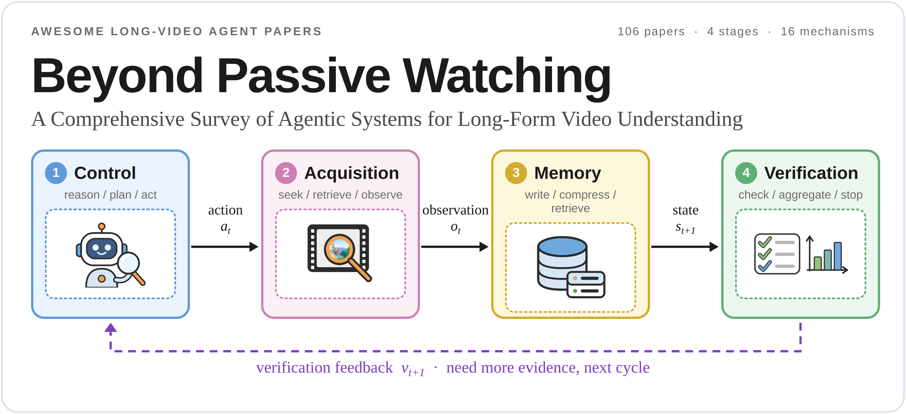
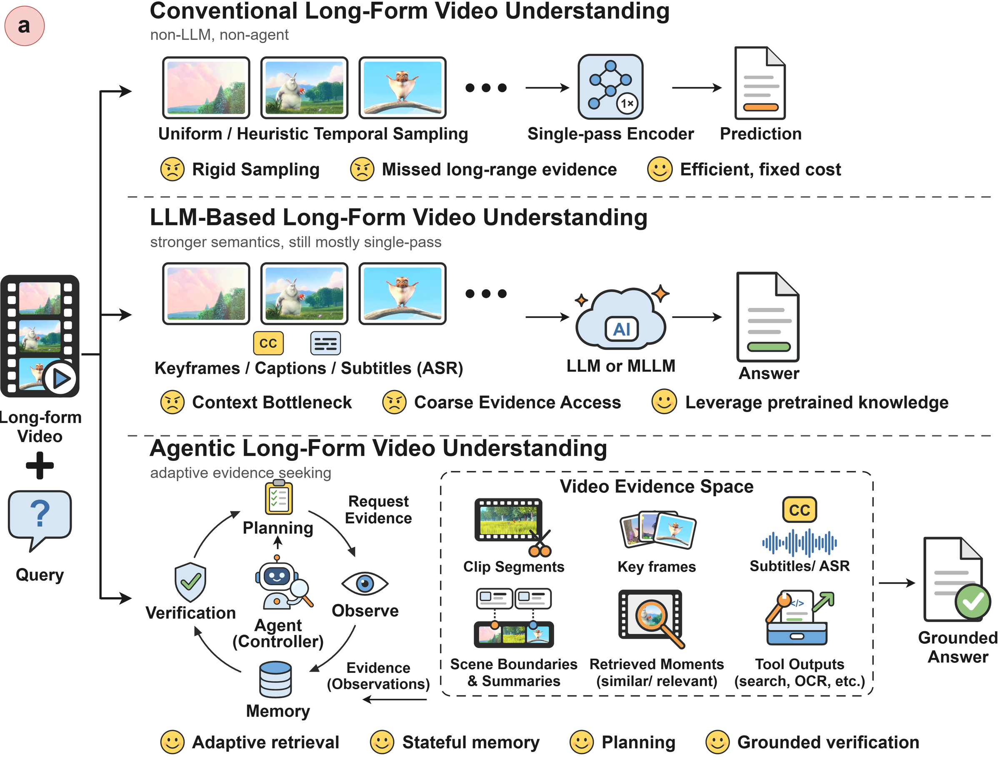
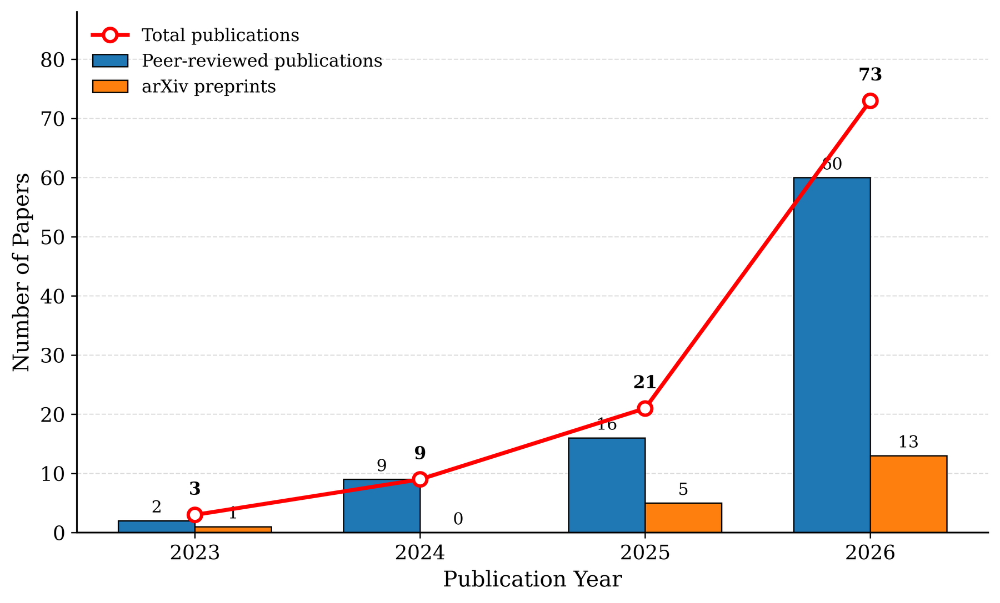
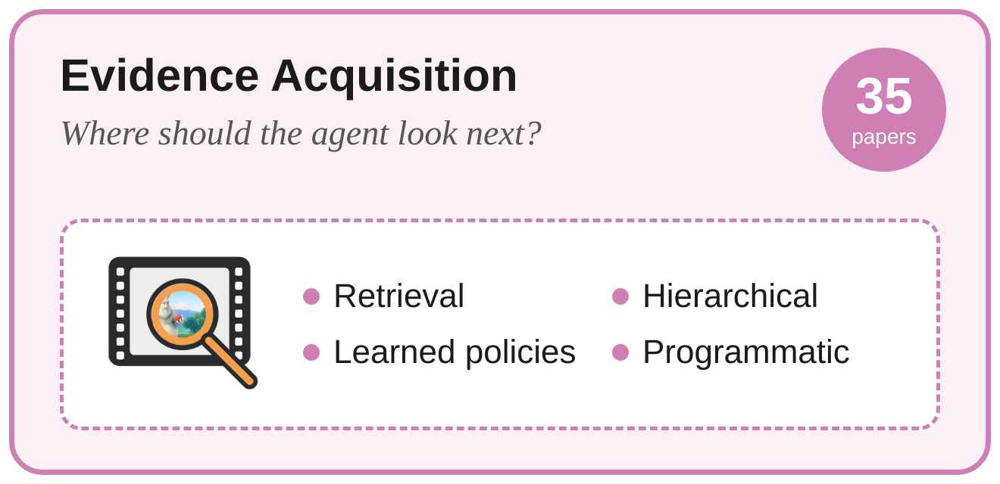
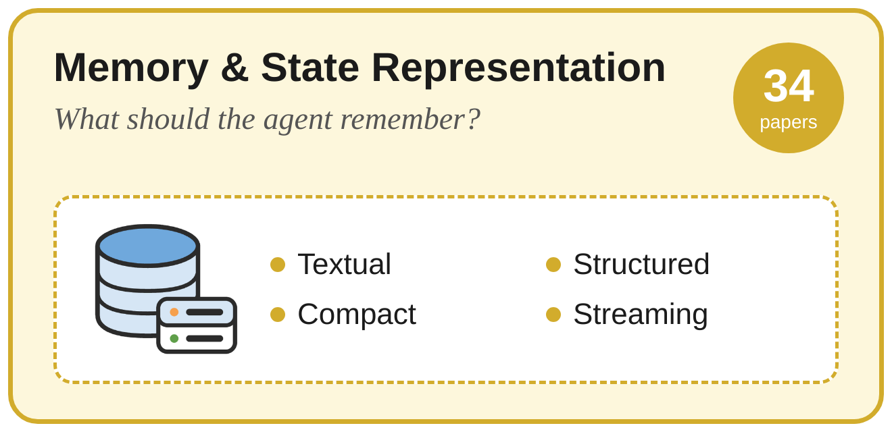
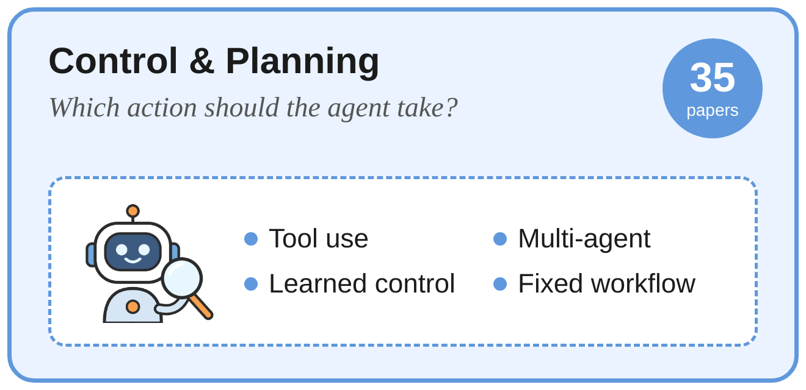
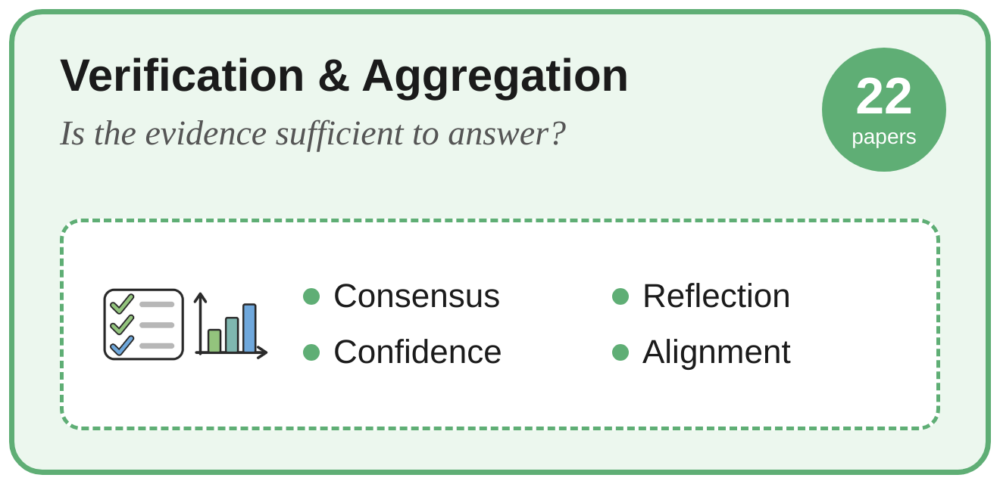
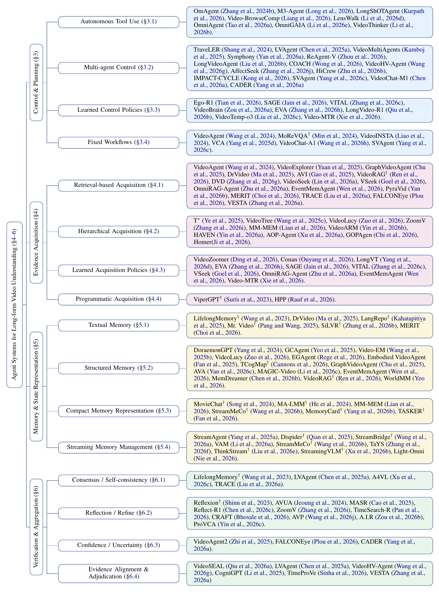
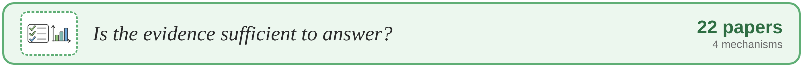

# Awesome Long-Video Agent Papers

**A curated, taxonomy-organized reading list on agentic systems for long-form video understanding.**

[**Taxonomy**](#taxonomy) &nbsp;·&nbsp; [**All papers by year**](papers/index.md) &nbsp;·&nbsp; [**Recent additions**](papers/recent-additions.md) &nbsp;·&nbsp; [**BibTeX**](references.bib) &nbsp;·&nbsp; [**Suggest a paper**](https://github.com/PhuTran1005/Awesome-Long-Video-Agent-Papers/issues/new?template=paper.yml)

## About the Survey

This repository accompanies **Beyond Passive Watching: A Comprehensive Survey of Agentic Systems for Long-Form Video Understanding**, a survey manuscript in preparation.

**[Project page](https://phutran1005.github.io/Awesome-Long-Video-Agent-Papers/) ? [Source, local preview, and deployment](docs/PROJECT_PAGE.md)**

Long videos make exhaustive, high-resolution processing expensive. Video agents address this challenge through **active evidence seeking**: they decide where to look, what to remember, which tool to call, and when the available evidence supports an answer. We organize this literature around four connected functions of the agent loop: **acquire** evidence, **remember** it, **plan** the next action, and **verify** the answer.

> [!NOTE]
> **What makes a video system agentic?** A later video-evidence action depends on an observation made earlier in the same inference trajectory. The defining feature is feedback from observed evidence into the next action.

  
   From passive processing to adaptive evidence seeking. Click the figure to view it at full resolution.

## Statistics

  
   Papers on agentic systems for long-form video understanding, by publication year. The 2026 cutoff is September 2026.

## Recent Additions

A growing reading list of **new methods that have not yet been incorporated into the survey taxonomy**. Entries are listed by release date, newest first, with provisional categories; papers join the taxonomy catalog after review and integration into the manuscript.

**[Browse recent additions →](papers/recent-additions.md)** · **[Suggest a new method](https://github.com/PhuTran1005/Awesome-Long-Video-Agent-Papers/issues/new?template=paper.yml)**

## Find Your Reading Path

| If you are interested in… | Start here | Continue with |
| :--- | :--- | :--- |
| Searching long videos efficiently | [Retrieval-based acquisition](#retrieval-based) | [Hierarchical acquisition](#hierarchical) |
| Remembering events across long horizons | [Structured memory](#structured) | [Streaming memory](#streaming) |
| Learning to reason with video tools | [Learned acquisition policies](#learned-acquisition) | [Learned control](#learned-control) |
| Coordinating specialized agents | [Multi-agent systems](#multi-agent) | [Evidence alignment & adjudication](#evidence-alignment) |
| Making answers more trustworthy | [Reflection / refine](#reflection) | [Confidence / uncertainty](#confidence) |

For a chronological view, open the **[complete paper index](papers/index.md)** and search by method, title, or first author.

## Taxonomy

Every paper in the survey is listed below, grouped by stage and mechanism. **Pick a stage card** to jump straight to its tables.

<!-- catalog-stats:start -->
**106 unique papers · 4 stages · 16 categories**
<!-- catalog-stats:end -->

<!-- taxonomy:start -->

  
  
  
  

  
   <b>The method-level taxonomy</b> from the survey appendix. Click to view at full resolution.

> **Reading the tables.** Categories are *non-exclusive*: a paper appears under every branch where it makes a substantive methodological contribution. Unmarked entries are *core video agents* whose later evidence-access actions depend on earlier video-derived observations. Entries marked with † (18 papers) are *agent-enabling methods or conceptual precursors*: they contribute useful video processing, memory, retrieval, or reflection mechanisms without independently establishing closed-loop video-evidence behavior.

## Evidence Acquisition

   

<b>Retrieval-Based Acquisition</b> &nbsp;&nbsp; <i>👆 click to expand</i>

Retrieve relevant moments, documents, or multimodal evidence in response to a query.

| Method | Paper | Links |
| :--- | :--- | :--- |
| <strong>DVD</strong>  | <a href="https://arxiv.org/abs/2505.18079">Deep video discovery: Agentic search with tool use for long-form video understanding</a> Xiaoyi Zhang et al. |   |
| <strong>EventMemAgent</strong>  | <a href="https://arxiv.org/abs/2602.15329">EventMemAgent: Hierarchical Event-Centric Memory for Online Video Understanding with Adaptive Tool Use</a> Siwei Wen et al. |   |
| <strong>FALCONEye</strong>  | FALCONEye: Finding Answers and Localizing Content in ONE-hour-long videos with multi-modal LLMs Carlos Plou et al. | [Find&nbsp;paper](https://scholar.google.com/scholar?q=%22FALCONEye%3A%20Finding%20Answers%20and%20Localizing%20Content%20in%20ONE-hour-long%20videos%20with%20multi-modal%20LLMs%22)  |
| <strong>MERIT</strong>  | <a href="https://arxiv.org/abs/2608.07663">Keep It Simple: Multi-Key Episodic Memory Retrieval for Ultra-Long Video Understanding</a> Yeeun Choi et al. |   |
| <strong>OmniRAG-Agent</strong>  | <a href="https://arxiv.org/abs/2602.03707">OmniRAG-Agent: Agentic Omnimodal Reasoning for Low-Resource Long Audio-Video Question Answering</a> Yifan Zhu et al. |   |
| <strong>PyraVid</strong>  | <a href="https://arxiv.org/abs/2605.17065">PyraVid: Hierarchical Multimodal Memory for Long-Horizon Video Reasoning</a> Sikuan Yan et al. |   |
| <strong>TRACE</strong>  | <a href="https://arxiv.org/abs/2608.22516">TRACE: Temporal Retrieval with Anchored and Convergent Evidence for Long-Horizon Video Understanding</a> Pengyiang Liu et al. |   |
| <strong>VESTA</strong>  | <a href="https://arxiv.org/abs/2608.31005">From Intent to Evidence: Policy-Steered Multi-Strategy Retrieval for Long-Video Agents</a> Can Zhang et al. |   |
| <strong>VideoRAG†</strong>  | <a href="https://arxiv.org/abs/2502.01549">Videorag: Retrieval-augmented generation with extreme long-context videos</a> Xubin Ren et al. |    |
| <strong>VideoSeek</strong>  | <a href="https://arxiv.org/abs/2603.20185">VideoSeek: Long-Horizon Video Agent with Tool-Guided Seeking</a> Jingyang Lin et al. |   |
| <strong>VSeek</strong>  | <a href="https://arxiv.org/abs/2607.02959">Incentivizing Vision Language Models to Search for Long Video Question Answering</a> Harsh Goel et al. |   |
| <strong>AVI</strong>  | <a href="https://arxiv.org/abs/2511.14446">Agentic Video Intelligence: A Flexible Framework for Advanced Video Exploration and Understanding</a> Hong Gao et al. |   |
| <strong>DrVideo</strong>  | <a href="https://arxiv.org/abs/2406.12846">Drvideo: Document retrieval based long video understanding</a> Ziyu Ma et al. |    |
| <strong>GraphVideoAgent</strong>  | <a href="https://doi.org/10.1145/3746027.3755537">GraphVideoAgent: Enhancing Long-form Video Understanding with Entity Relation Graphs</a> Meng Chu et al. |   |
| <strong>VideoExplorer</strong>  | <a href="https://arxiv.org/abs/2506.10821">VideoExplorer: Think With Videos For Agentic Long-Video Understanding</a> Huaying Yuan et al. |   |
| <strong>VideoAgent</strong>  | <a href="https://arxiv.org/abs/2403.10517">Videoagent: Long-form video understanding with large language model as agent</a> Xiaohan Wang et al. |    |

<a href="#taxonomy">↑ Back to taxonomy</a>

<b>Hierarchical Acquisition</b> &nbsp;&nbsp; <i>👆 click to expand</i>

Navigate from coarse summaries to finer temporal or spatial evidence.

| Method | Paper | Links |
| :--- | :--- | :--- |
| <strong>AOP-Agent</strong>  | <a href="https://arxiv.org/abs/2605.28192">Agentic Active Omni-Modal Perception for Multi-Hop Audio-Visual Reasoning</a> Ke Xu et al. |   |
| <strong>GOPAgen</strong>  | <a href="https://arxiv.org/abs/2606.06532">GOPAgen: Motion-Aware and Efficient Agentic Long-Video Understanding with Structural Memory and Hierarchical Reasoning</a> Haozhe Chi et al. |   |
| <strong>HAVEN</strong>  | Hierarchical Long Video Understanding with Audiovisual Entity Cohesion and Agentic Search Xinlei Yin et al. | [Find&nbsp;paper](https://scholar.google.com/scholar?q=%22Hierarchical%20Long%20Video%20Understanding%20with%20Audiovisual%20Entity%20Cohesion%20and%20Agentic%20Search%22)  |
| <strong>Homer</strong>  | <a href="https://arxiv.org/abs/2607.02588">Homer: Understanding Long-form Videos with Hierarchical Memory and Agentic Reasoning</a> Yixin Ji et al. |   |
| <strong>MM-MEM</strong>  | <a href="https://arxiv.org/abs/2603.01455">From verbatim to gist: Distilling pyramidal multimodal memory via semantic information bottleneck for long-horizon video agents</a> Niu Lian et al. |   |
| <strong>VideoARM</strong>  | <a href="https://arxiv.org/abs/2512.12360">Videoarm: Agentic reasoning over hierarchical memory for long-form video understanding</a> Yufei Yin et al. |   |
| <strong>VideoLucy</strong>  | Videolucy: Deep memory backtracking for long video understanding Jialong Zuo et al. | [Find&nbsp;paper](https://scholar.google.com/scholar?q=%22Videolucy%3A%20Deep%20memory%20backtracking%20for%20long%20video%20understanding%22)  |
| <strong>ZoomV</strong>  | <a href="https://arxiv.org/abs/2504.01407">ZoomV: Temporal Zoom-in for Efficient Long Video Understanding</a> Yuan Zhang et al. |   |
| <strong>T*</strong>  | <a href="https://arxiv.org/abs/2504.02259">Re-thinking temporal search for long-form video understanding</a> Jinhui Ye et al. |   |
| <strong>VideoTree</strong>  | Videotree: Adaptive tree-based video representation for llm reasoning on long videos Ziyang Wang et al. | [Find&nbsp;paper](https://scholar.google.com/scholar?q=%22Videotree%3A%20Adaptive%20tree-based%20video%20representation%20for%20llm%20reasoning%20on%20long%20videos%22)  |

<a href="#taxonomy">↑ Back to taxonomy</a>

<b>Learned Acquisition Policies</b> &nbsp;&nbsp; <i>👆 click to expand</i>

Learn when, where, or at what granularity to acquire the next observation.

| Method | Paper | Links |
| :--- | :--- | :--- |
| <strong>Conan</strong>  | <a href="https://arxiv.org/abs/2510.20470">Conan: Progressive learning to reason like a detective over multi-scale visual evidence</a> Kun Ouyang et al. |   |
| <strong>EVA</strong>  | <a href="https://arxiv.org/abs/2603.22918">EVA: Efficient Reinforcement Learning for End-to-End Video Agent</a> Yaolun Zhang et al. |   |
| <strong>EventMemAgent</strong>  | <a href="https://arxiv.org/abs/2602.15329">EventMemAgent: Hierarchical Event-Centric Memory for Online Video Understanding with Adaptive Tool Use</a> Siwei Wen et al. |   |
| <strong>LongVT</strong>  | <a href="https://arxiv.org/abs/2511.20785">Longvt: Incentivizing" thinking with long videos" via native tool calling</a> Zuhao Yang et al. |    |
| <strong>OmniRAG-Agent</strong>  | <a href="https://arxiv.org/abs/2602.03707">OmniRAG-Agent: Agentic Omnimodal Reasoning for Low-Resource Long Audio-Video Question Answering</a> Yifan Zhu et al. |   |
| <strong>SAGE</strong>  | <a href="https://arxiv.org/abs/2512.13874">Sage: Training smart any-horizon agents for long video reasoning with reinforcement learning</a> Jitesh Jain et al. |   |
| <strong>Video-MTR</strong>  | <a href="https://openreview.net/forum?id=UhPwL6LYOc">Video-MTR: Reinforced Multi-Turn Reasoning for Long Video Understanding</a> Yuan Xie et al. |   |
| <strong>VideoZoomer</strong>  | <a href="https://openreview.net/forum?id=ARHCFvgx6G">VideoZoomer: Reinforcement-Learned Temporal Focusing for Long Video Reasoning</a> Yang Ding et al. |   |
| <strong>VITAL</strong>  | <a href="https://arxiv.org/abs/2508.04416">Thinking with videos: Multimodal tool-augmented reinforcement learning for long video reasoning</a> Haoji Zhang et al. |   |
| <strong>VSeek</strong>  | <a href="https://arxiv.org/abs/2607.02959">Incentivizing Vision Language Models to Search for Long Video Question Answering</a> Harsh Goel et al. |   |

<a href="#taxonomy">↑ Back to taxonomy</a>

<b>Programmatic Acquisition</b> &nbsp;&nbsp; <i>👆 click to expand</i>

Compose executable programs that probe video content with perception tools.

| Method | Paper | Links |
| :--- | :--- | :--- |
| <strong>HPP</strong>  | <a href="https://arxiv.org/abs/2606.21734">HPP: Hierarchical Programmatic Probing for Long Video Understanding by Decoupling Perception and Reasoning</a> Awais Rauf et al. |   |
| <strong>ViperGPT†</strong>  | <a href="https://arxiv.org/abs/2303.08128">Vipergpt: Visual inference via python execution for reasoning</a> Dídac Surís et al. |    |

<a href="#taxonomy">↑ Back to taxonomy</a>

## Memory & State Representation

   

<b>Textual Memory</b> &nbsp;&nbsp; <i>👆 click to expand</i>

Retain captions, textual summaries, and language-based accounts of past observations.

| Method | Paper | Links |
| :--- | :--- | :--- |
| <strong>MERIT</strong>  | <a href="https://arxiv.org/abs/2608.07663">Keep It Simple: Multi-Key Episodic Memory Retrieval for Ultra-Long Video Understanding</a> Yeeun Choi et al. |   |
| <strong>SiLVR†</strong>  | <a href="https://openreview.net/forum?id=mQZbh9Zlbw">SiLVR: A Simple Language-based Video Reasoning Framework</a> Ce Zhang et al. |   |
| <strong>DrVideo</strong>  | <a href="https://arxiv.org/abs/2406.12846">Drvideo: Document retrieval based long video understanding</a> Ziyu Ma et al. |    |
| <strong>LangRepo†</strong>  | <a href="https://arxiv.org/abs/2403.14622">Language repository for long video understanding</a> Kumara Kahatapitiya et al. |   |
| <strong>Mr. Video†</strong>  | <a href="https://openreview.net/forum?id=7n2Kv5BUz2">MR. Video: MapReduce as an Effective Principle for Long Video Understanding</a> Ziqi Pang et al. |   |
| <strong>LifelongMemory†</strong>  | <a href="https://arxiv.org/abs/2312.05269">Lifelongmemory: Leveraging llms for answering queries in long-form egocentric videos</a> Ying Wang et al. |   |

<a href="#taxonomy">↑ Back to taxonomy</a>

<b>Structured Memory</b> &nbsp;&nbsp; <i>👆 click to expand</i>

Organize evidence as events, entities, graphs, or other explicitly addressable structures.

| Method | Paper | Links |
| :--- | :--- | :--- |
| <strong>AVA</strong>  | <a href="https://www.usenix.org/conference/nsdi26/presentation/yan">AVA: Towards Agentic Video Analytics with Vision Language Models</a> Yuxuan Yan et al. |   |
| <strong>EGAgent</strong>  | <a href="https://aclanthology.org/2026.acl-long.2161/">Agentic Very Long Video Understanding</a> Aniket Rege et al. |   |
| <strong>EventMemAgent</strong>  | <a href="https://arxiv.org/abs/2602.15329">EventMemAgent: Hierarchical Event-Centric Memory for Online Video Understanding with Adaptive Tool Use</a> Siwei Wen et al. |   |
| <strong>MAGIC-Video</strong>  | <a href="https://arxiv.org/abs/2605.08271">Bridging Modalities, Spanning Time: Structured Memory for Ultra-Long Agentic Video Reasoning</a> Jiazheng Li et al. |   |
| <strong>MemDreamer</strong>  | <a href="https://arxiv.org/abs/2606.07512">MemDreamer: Decoupling Perception and Reasoning for Long Video Understanding via Hierarchical Graph Memory and Agentic Retrieval Mechanism</a> Cong Chen et al. |   |
| <strong>TCogMap†</strong>  | <a href="https://openreview.net/forum?id=ZTnt0PzHnL">From Segments to Scenes: Temporal Understanding for Agentic Autonomous Driving via Vision-Language Models</a> Kevin Cannons et al. |   |
| <strong>VideoLucy</strong>  | Videolucy: Deep memory backtracking for long video understanding Jialong Zuo et al. | [Find&nbsp;paper](https://scholar.google.com/scholar?q=%22Videolucy%3A%20Deep%20memory%20backtracking%20for%20long%20video%20understanding%22)  |
| <strong>VideoRAG†</strong>  | <a href="https://arxiv.org/abs/2502.01549">Videorag: Retrieval-augmented generation with extreme long-context videos</a> Xubin Ren et al. |    |
| <strong>WorldMM</strong>  | <a href="https://arxiv.org/abs/2512.02425">Worldmm: Dynamic multimodal memory agent for long video reasoning</a> Woongyeong Yeo et al. |   |
| <strong>Embodied VideoAgent</strong>  | <a href="https://arxiv.org/abs/2501.00358">Embodied videoagent: Persistent memory from egocentric videos and embodied sensors enables dynamic scene understanding</a> Yue Fan et al. |   |
| <strong>GCAgent</strong>  | <a href="https://arxiv.org/abs/2511.12027">Gcagent: Long-video understanding via schematic and narrative episodic memory</a> Jeong Hun Yeo et al. |   |
| <strong>GraphVideoAgent</strong>  | <a href="https://doi.org/10.1145/3746027.3755537">GraphVideoAgent: Enhancing Long-form Video Understanding with Entity Relation Graphs</a> Meng Chu et al. |   |
| <strong>Video-EM</strong>  | <a href="https://arxiv.org/abs/2508.09486">Video-EM: Event-Centric Episodic Memory for Long-Form Video Understanding</a> Yun Wang et al. |   |
| <strong>DoraemonGPT</strong>  | <a href="https://openreview.net/forum?id=QMy2RLnxGN">DoraemonGPT: Toward Understanding Dynamic Scenes with Large Language Models (Exemplified as A Video Agent)</a> Zongxin Yang et al. |   |

<a href="#taxonomy">↑ Back to taxonomy</a>

<b>Compact Memory Representation</b> &nbsp;&nbsp; <i>👆 click to expand</i>

Maintain compact latent representations that reduce the cost of storing and revisiting video context.

| Method | Paper | Links |
| :--- | :--- | :--- |
| <strong>MemoryCard†</strong>  | <a href="https://arxiv.org/abs/2606.05917">MemoryCard: Topic-Aware Multi-Modal Clue Compression for Long-Video Question Answering</a> Qing Yang et al. |   |
| <strong>MM-MEM</strong>  | <a href="https://arxiv.org/abs/2603.01455">From verbatim to gist: Distilling pyramidal multimodal memory via semantic information bottleneck for long-horizon video agents</a> Niu Lian et al. |   |
| <strong>StreamMeCo†</strong>  | <a href="https://aclanthology.org/2026.findings-acl.647/">Streammeco: Long-term agent memory compression for efficient streaming video understanding</a> Junxi Wang et al. |   |
| <strong>TASKER†</strong>  | <a href="https://arxiv.org/abs/2606.29445">Bridging VideoQA and Video-Guided Agentic Tasks via Generalized Keyframe Extraction</a> Sunqi Fan et al. |   |
| <strong>MA-LMM†</strong>  | <a href="https://arxiv.org/abs/2404.05726">Ma-lmm: Memory-augmented large multimodal model for long-term video understanding</a> Bo He et al. |    |
| <strong>MovieChat†</strong>  | <a href="https://arxiv.org/abs/2307.16449">Moviechat: From dense token to sparse memory for long video understanding</a> Enxin Song et al. |   |

<a href="#taxonomy">↑ Back to taxonomy</a>

<b>Streaming Memory Management</b> &nbsp;&nbsp; <i>👆 click to expand</i>

Update memory as new observations arrive and support reasoning over an evolving stream.

| Method | Paper | Links |
| :--- | :--- | :--- |
| <strong>Light-Omni</strong>  | <a href="https://arxiv.org/abs/2607.05511">Light-Omni: Reflex over Reasoning in Agentic Video Understanding with Long-Term Memory</a> Chang Nie et al. |   |
| <strong>StreamBridge†</strong>  | <a href="https://arxiv.org/abs/2505.05467">Streambridge: Turning your offline video large language model into a proactive streaming assistant</a> Haibo Wang et al. |   |
| <strong>StreamingVLM†</strong>  | <a href="https://openreview.net/forum?id=gVbPWbA97s">StreamingVLM: Real-Time Understanding for Infinite Video Streams</a> Ruyi Xu et al. |   |
| <strong>StreamMeCo†</strong>  | <a href="https://aclanthology.org/2026.findings-acl.647/">Streammeco: Long-term agent memory compression for efficient streaming video understanding</a> Junxi Wang et al. |   |
| <strong>TaYS</strong>  | <a href="https://arxiv.org/abs/2603.02872">Think-as-you-see: Streaming chain-of-thought reasoning for large vision-language models</a> Jialiang Zhang et al. |   |
| <strong>ThinkStream†</strong>  | <a href="https://arxiv.org/abs/2603.12938">Thinking in streaming video</a> Zikang Liu et al. |   |
| <strong>VAM</strong>  | <a href="https://arxiv.org/abs/2605.16481">Visual Agentic Memory: Enabling Online Long Video Understanding via Online Indexing, Hierarchical Memory, and Agentic Retrieval</a> Aiden Yiliu Li et al. |   |
| <strong>Dispider†</strong>  | <a href="https://arxiv.org/abs/2501.03218">Dispider: Enabling video llms with active real-time interaction via disentangled perception, decision, and reaction</a> Rui Qian et al. |    |
| <strong>StreamAgent</strong>  | <a href="https://arxiv.org/abs/2508.01875">Streamagent: Towards anticipatory agents for streaming video understanding</a> Haolin Yang et al. |   |

<a href="#taxonomy">↑ Back to taxonomy</a>

## Control & Planning

   

<b>Autonomous Tool Use</b> &nbsp;&nbsp; <i>👆 click to expand</i>

Let a controller choose and invoke tools as the evidence and task evolve.

| Method | Paper | Links |
| :--- | :--- | :--- |
| <strong>LensWalk</strong>  | <a href="https://arxiv.org/abs/2603.24558">LensWalk: Agentic video understanding by planning how you see in videos</a> Keliang Li et al. |   |
| <strong>LongShOTAgent</strong>  | <a href="https://arxiv.org/abs/2512.16978">A Benchmark for Omni-Modal Reasoning in Long Videos</a> Mohammed Irfan Kurpath et al. |   |
| <strong>M3-Agent</strong>  | <a href="https://openreview.net/forum?id=PMz29A7Muq">Seeing, Listening, Remembering, and Reasoning: A Multimodal Agent with Long-Term Memory</a> Lin Long et al. |   |
| <strong>OmniAgent</strong>  | <a href="https://arxiv.org/abs/2512.23646">Active Perception Agent for Omnimodal Audio-Video Understanding</a> Keda Tao et al. |   |
| <strong>OmniGAIA</strong>  | <a href="https://arxiv.org/abs/2602.22897">OmniGAIA: Towards Native Omni-Modal AI Agents</a> Xiaoxi Li et al. |   |
| <strong>Video-BrowseComp</strong>  | <a href="https://arxiv.org/abs/2512.23044">Video-Browser: Towards Agentic Open-web Video Browsing</a> Zhengyang Liang et al. |   |
| <strong>VideoThinker</strong>  | <a href="https://arxiv.org/abs/2601.15724">VideoThinker: Building Agentic VideoLLMs with LLM-Guided Tool Reasoning</a> Chenglin Li et al. |   |
| <strong>OmAgent</strong>  | <a href="https://arxiv.org/abs/2406.16620">Omagent: A multi-modal agent framework for complex video understanding with task divide-and-conquer</a> Lu Zhang et al. |   |

<a href="#taxonomy">↑ Back to taxonomy</a>

<b>Multi-Agent Control</b> &nbsp;&nbsp; <i>👆 click to expand</i>

Distribute perception, reasoning, and coordination across collaborating agents.

| Method | Paper | Links |
| :--- | :--- | :--- |
| <strong>AffectSeek</strong>  | <a href="https://arxiv.org/abs/2605.05640">AffectSeek: Agentic Affective Understanding in Long Videos under Vague User Queries</a> Zhen Zhang et al. |   |
| <strong>CADER</strong>  | <a href="https://arxiv.org/abs/2607.24582">CADER: Confidence-Aware Dynamic Evidence Reasoning for Long-Video Understanding</a> Jinlong Yang et al. |   |
| <strong>COACH</strong>  | <a href="https://openreview.net/forum?id=PrJ80Pvii2">COACH: Collaborative Agents for Contextual Highlighting A Multi-Agent Framework for Sports Video Analysis</a> Tsz-To Wong et al. |   |
| <strong>HiCrew</strong>  | <a href="https://arxiv.org/abs/2604.21444">HiCrew: Hierarchical Reasoning for Long-Form Video Understanding via Question-Aware Multi-Agent Collaboration</a> Yuehan Zhu et al. |   |
| <strong>IMPACT-CYCLE</strong>  | <a href="https://arxiv.org/abs/2604.20136">IMPACT-CYCLE: A Contract-Based Multi-Agent System for Claim-Level Supervisory Correction of Long-Video Semantic Memory</a> Weitong Kong et al. |   |
| <strong>LongVideoAgent</strong>  | <a href="https://arxiv.org/abs/2512.20618">Longvideoagent: Multi-agent reasoning with long videos</a> Runtao Liu et al. |   |
| <strong>ReAgent-V</strong>  | <a href="https://arxiv.org/abs/2506.01300">Reagent-v: A reward-driven multi-agent framework for video understanding</a> Yiyang Zhou et al. |   |
| <strong>SVAgent</strong>  | SVAgent: Storyline-guided Long Video Understanding via Cross-Modal Multi-Agent Collaboration Zhongyu Yang et al. | [Find&nbsp;paper](https://scholar.google.com/scholar?q=%22SVAgent%3A%20Storyline-guided%20Long%20Video%20Understanding%20via%20Cross-Modal%20Multi-Agent%20Collaboration%22)  |
| <strong>Symphony</strong>  | <a href="https://arxiv.org/abs/2603.17307">Symphony: A Cognitively-Inspired Multi-Agent System for Long-Video Understanding</a> Haiyang Yan et al. |   |
| <strong>VideoChat-M1</strong>  | <a href="https://arxiv.org/abs/2511.19524">Videochat-m1: Collaborative policy planning for video understanding via multi-agent reinforcement learning</a> Boyu Chen et al. |   |
| <strong>VideoHV-Agent</strong>  | <a href="https://arxiv.org/abs/2603.04977">Think, Then Verify: A Hypothesis-Verification Multi-Agent Framework for Long Video Understanding</a> Zheng Wang et al. |   |
| <strong>LVAgent</strong>  | <a href="https://arxiv.org/abs/2503.10200">Lvagent: Long video understanding by multi-round dynamical collaboration of mllm agents</a> Boyu Chen et al. |    |
| <strong>VideoMultiAgents</strong>  | <a href="https://openreview.net/forum?id=nBp1omOQ4P">A Multi-agent Reasoning Framework for Video Question Answering</a> Abhi Kamboj et al. |   |
| <strong>TraveLER</strong>  | <a href="https://arxiv.org/abs/2404.01476">TraveLER: A Modular Multi-LMM Agent Framework for Video Question-Answering</a> Chuyi Shang et al. |   |

<a href="#taxonomy">↑ Back to taxonomy</a>

<b>Learned Control Policies</b> &nbsp;&nbsp; <i>👆 click to expand</i>

Learn action selection and planning policies for long-horizon video reasoning.

| Method | Paper | Links |
| :--- | :--- | :--- |
| <strong>Ego-R1</strong>  | <a href="https://arxiv.org/abs/2506.13654">Ego-R1: Agentic Chain-of-Tool-Thought for Ultra-Long Egocentric Video Reasoning</a> Shulin Tian et al. |   |
| <strong>EVA</strong>  | <a href="https://arxiv.org/abs/2603.22918">EVA: Efficient Reinforcement Learning for End-to-End Video Agent</a> Yaolun Zhang et al. |   |
| <strong>LongVideo-R1</strong>  | <a href="https://arxiv.org/abs/2602.20913">Longvideo-r1: Smart navigation for low-cost long video understanding</a> Jihao Qiu et al. |   |
| <strong>SAGE</strong>  | <a href="https://arxiv.org/abs/2512.13874">Sage: Training smart any-horizon agents for long video reasoning with reinforcement learning</a> Jitesh Jain et al. |   |
| <strong>Video-MTR</strong>  | <a href="https://openreview.net/forum?id=UhPwL6LYOc">Video-MTR: Reinforced Multi-Turn Reasoning for Long Video Understanding</a> Yuan Xie et al. |   |
| <strong>VideoBrain</strong>  | <a href="https://openreview.net/forum?id=1TXn0PeBZJ">VideoBrain: Learning Adaptive Frame Sampling for Long Video Understanding</a> Junbo Zou et al. |   |
| <strong>VideoTemp-o3</strong>  | <a href="https://openreview.net/forum?id=DlKdI669OM">VideoTemp-o3: Harmonizing Temporal Grounding and Video Understanding in Agentic Thinking-with-Videos</a> Wenqi Liu et al. |   |
| <strong>VITAL</strong>  | <a href="https://arxiv.org/abs/2508.04416">Thinking with videos: Multimodal tool-augmented reinforcement learning for long video reasoning</a> Haoji Zhang et al. |   |

<a href="#taxonomy">↑ Back to taxonomy</a>

<b>Fixed Workflows</b> &nbsp;&nbsp; <i>👆 click to expand</i>

Coordinate evidence processing through a predefined sequence of stages.

| Method | Paper | Links |
| :--- | :--- | :--- |
| <strong>SVAgent</strong>  | SVAgent: Storyline-guided Long Video Understanding via Cross-Modal Multi-Agent Collaboration Zhongyu Yang et al. | [Find&nbsp;paper](https://scholar.google.com/scholar?q=%22SVAgent%3A%20Storyline-guided%20Long%20Video%20Understanding%20via%20Cross-Modal%20Multi-Agent%20Collaboration%22)  |
| <strong>VideoChat-A1</strong>  | <a href="https://arxiv.org/abs/2506.06097">Videochat-a1: Thinking with long videos by chain-of-shot reasoning</a> Zikang Wang et al. |   |
| <strong>VCA</strong>  | <a href="https://arxiv.org/abs/2412.10471">Vca: Video curious agent for long video understanding</a> Zeyuan Yang et al. |   |
| <strong>MoReVQA†</strong>  | <a href="https://arxiv.org/abs/2404.06511">Morevqa: Exploring modular reasoning models for video question answering</a> Juhong Min et al. |   |
| <strong>VideoAgent</strong>  | <a href="https://arxiv.org/abs/2403.10517">Videoagent: Long-form video understanding with large language model as agent</a> Xiaohan Wang et al. |    |
| <strong>VideoINSTA</strong>  | <a href="https://arxiv.org/abs/2409.20365">Videoinsta: Zero-shot long video understanding via informative spatial-temporal reasoning with llms</a> Ruotong Liao et al. |   |

<a href="#taxonomy">↑ Back to taxonomy</a>

## Verification & Aggregation

   

<b>Consensus / Self-Consistency</b> &nbsp;&nbsp; <i>👆 click to expand</i>

Compare candidate answers or reasoning paths to assess agreement.

| Method | Paper | Links |
| :--- | :--- | :--- |
| <strong>A4VL</strong>  | <a href="https://openreview.net/forum?id=N3kgr2kNGt">A Multi-Agent Perception-Action Alliance for Efficient Long Video Reasoning</a> Yichang Xu et al. |   |
| <strong>TRACE</strong>  | <a href="https://arxiv.org/abs/2608.22516">TRACE: Temporal Retrieval with Anchored and Convergent Evidence for Long-Horizon Video Understanding</a> Pengyiang Liu et al. |   |
| <strong>LVAgent</strong>  | <a href="https://arxiv.org/abs/2503.10200">Lvagent: Long video understanding by multi-round dynamical collaboration of mllm agents</a> Boyu Chen et al. |    |
| <strong>LifelongMemory†</strong>  | <a href="https://arxiv.org/abs/2312.05269">Lifelongmemory: Leveraging llms for answering queries in long-form egocentric videos</a> Ying Wang et al. |   |

<a href="#taxonomy">↑ Back to taxonomy</a>

<b>Reflection / Refine</b> &nbsp;&nbsp; <i>👆 click to expand</i>

Revisit evidence and revise an answer or plan through feedback.

| Method | Paper | Links |
| :--- | :--- | :--- |
| <strong>A.I.R</strong>  | <a href="https://openreview.net/forum?id=SZVpOKw0YD">A.I.R.: Enabling Adaptive, Iterative, and Reasoning-based Frame Selection For Video Question Answering</a> Yuanhao Zou et al. |   |
| <strong>AVP</strong>  | <a href="https://arxiv.org/abs/2512.05774">Active video perception: Iterative evidence seeking for agentic long video understanding</a> Ziyang Wang et al. |   |
| <strong>CRAFT</strong>  | <a href="https://arxiv.org/abs/2605.19075">Craft: Critic-refined adaptive key-frame targeting for multimodal video question answering</a> Mahesh Bhosale et al. |   |
| <strong>ProVCA</strong>  | <a href="https://arxiv.org/abs/2604.02891">Progressive Video Condensation with MLLM Agent for Long-form Video Understanding</a> Yufei Yin et al. |   |
| <strong>Reflect-R1</strong>  | <a href="https://arxiv.org/abs/2606.27922">Reflect-R1: Evidence-Driven Reflection for Self-Correction in Long Video Understanding</a> Shuimu Chen et al. |   |
| <strong>TimeSearch-R</strong>  | <a href="https://openreview.net/forum?id=gqb1hvuGcj">TimeSearch-R: Adaptive Temporal Search for Long-Form Video Understanding via Self-Verification Reinforcement Learning</a> Junwen Pan et al. |   |
| <strong>ZoomV</strong>  | <a href="https://arxiv.org/abs/2504.01407">ZoomV: Temporal Zoom-in for Efficient Long Video Understanding</a> Yuan Zhang et al. |   |
| <strong>MASR</strong>  | <a href="https://arxiv.org/abs/2504.17213">MASR: Self-Reflective Reasoning through Multimodal Hierarchical Attention Focusing for Agent-based Video Understanding</a> Shiwen Cao et al. |   |
| <strong>AVUA</strong>  | <a href="https://arxiv.org/abs/2410.20252">Adaptive video understanding agent: Enhancing efficiency with dynamic frame sampling and feedback-driven reasoning</a> Sullam Jeoung et al. |   |
| <strong>Reflexion†</strong>  | <a href="https://arxiv.org/abs/2303.11366">Reflexion: Language agents with verbal reinforcement learning</a> Noah Shinn et al. |   |

<a href="#taxonomy">↑ Back to taxonomy</a>

<b>Confidence / Uncertainty</b> &nbsp;&nbsp; <i>👆 click to expand</i>

Use uncertainty estimates to guide reasoning and evidence seeking.

| Method | Paper | Links |
| :--- | :--- | :--- |
| <strong>CADER</strong>  | <a href="https://arxiv.org/abs/2607.24582">CADER: Confidence-Aware Dynamic Evidence Reasoning for Long-Video Understanding</a> Jinlong Yang et al. |   |
| <strong>FALCONEye</strong>  | FALCONEye: Finding Answers and Localizing Content in ONE-hour-long videos with multi-modal LLMs Carlos Plou et al. | [Find&nbsp;paper](https://scholar.google.com/scholar?q=%22FALCONEye%3A%20Finding%20Answers%20and%20Localizing%20Content%20in%20ONE-hour-long%20videos%20with%20multi-modal%20LLMs%22)  |
| <strong>VideoAgent2</strong>  | <a href="https://openreview.net/forum?id=MD8QyIZIoE">VideoAgent2: Enhancing the LLM-Based Agent System for Long-Form Video Understanding by Uncertainty-Aware CoT</a> Zhuo Zhi et al. |   |

<a href="#taxonomy">↑ Back to taxonomy</a>

<b>Evidence Alignment & Adjudication</b> &nbsp;&nbsp; <i>👆 click to expand</i>

Check claims against evidence and reconcile conflicting observations or agent outputs.

| Method | Paper | Links |
| :--- | :--- | :--- |
| <strong>TimeProVe</strong>  | <a href="https://arxiv.org/abs/2606.20561">TimeProVe: Propose, then Verify for Efficient Long Video Temporal Reasoning in Activities of Daily Living</a> Arkaprava Sinha et al. |   |
| <strong>VESTA</strong>  | <a href="https://arxiv.org/abs/2608.31005">From Intent to Evidence: Policy-Steered Multi-Strategy Retrieval for Long-Video Agents</a> Can Zhang et al. |   |
| <strong>VideoHV-Agent</strong>  | <a href="https://arxiv.org/abs/2603.04977">Think, Then Verify: A Hypothesis-Verification Multi-Agent Framework for Long Video Understanding</a> Zheng Wang et al. |   |
| <strong>VideoSEAL</strong>  | <a href="https://openreview.net/forum?id=RsPequeaiZ">VideoSEAL: Mitigating Evidence Misalignment in Agentic Long Video Understanding by Decoupling Answer Authority</a> Chenhao Qiu et al. |   |
| <strong>CogniGPT</strong>  | <a href="https://arxiv.org/abs/2509.24943">Perceive, Reflect and Understand Long Video: Progressive Multi-Granular Clue Exploration with Interactive Agents</a> Jiahua Li et al. |   |
| <strong>LVAgent</strong>  | <a href="https://arxiv.org/abs/2503.10200">Lvagent: Long video understanding by multi-round dynamical collaboration of mllm agents</a> Boyu Chen et al. |    |

<a href="#taxonomy">↑ Back to taxonomy</a>

<!-- taxonomy:end -->

## Collection & Bibliography

The collection maps the manuscript's `sections/taxonomy.tex` to `custom.bib` using exact citation keys. Bibliographic years and venues are retained from that source; a linked preprint may have an earlier release date than the listed publication year.

| Resource | What you will find |
| :--- | :--- |
| [Taxonomy tables](#taxonomy) | Every paper, grouped by stage and mechanism (this page) |
| [Paper index](papers/index.md) | A deduplicated chronological index with links back to each taxonomy branch |
| [Recent additions](papers/recent-additions.md) | New methods awaiting taxonomy integration, with provisional categories |
| [BibTeX bibliography](references.bib) | All taxonomy citation records, with their original keys |
| [Verified code links](data/code-links.json) | Official repositories and primary sources used to confirm each link |
| [Structured catalog](data/catalog.json) | Titles, authors, venues, citation aliases, and all category assignments |
| [Data notes](docs/DATA_NOTES.md) | Provenance, duplicate handling, link sources, and metadata conventions |

### Badge Colors

| Badge | Meaning |
| :--- | :--- |
|  | `red` for arXiv papers |
|  | `blue` for conference and journal papers |
|  | `dark` for official code repositories, with a live star count |
|     | one color per stage, taken from the survey's pipeline figure: pink, gold, blue, green |

Venue badges separate the **venue** (dark gray) from the **year**, following the bibliography. A conference or journal paper may also link to its red **arXiv** preprint. **Find paper** opens a title search when no direct identifier is available. Star counts are served by Shields.io and may refresh with a caching delay. Full author lists are available in the bibliography and structured catalog.

## Contributing

> [!IMPORTANT]
> Relevant papers, metadata corrections, and taxonomy suggestions are welcome. Please include a primary publication link and explain how the work fits a stage of the agent loop.

**[Read the contribution guide](CONTRIBUTING.md)** · **[Suggest a paper](https://github.com/PhuTran1005/Awesome-Long-Video-Agent-Papers/issues/new?template=paper.yml)** · **[Report a correction](https://github.com/PhuTran1005/Awesome-Long-Video-Agent-Papers/issues/new?template=correction.yml)**

## Citation

The survey's public paper link and formal citation will be added when available. Until then, please cite the individual papers using [references.bib](references.bib).

## Acknowledgments & License

The repository layout is inspired by [Awesome Multimodal Token Compression](https://github.com/cokeshao/Awesome-Multimodal-Token-Compression). We thank the authors whose research makes this collection possible.

Repository materials are provided under the existing [Apache 2.0 license](LICENSE). Linked papers and external resources remain subject to their respective licenses.

## Star History

  

Explore the evidence. Follow the reasoning. Keep the sources close.

